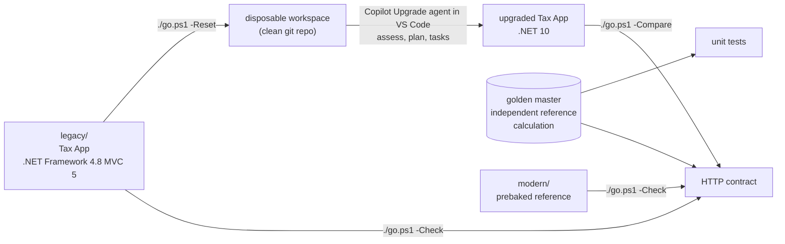

# Demo 21: modernize a .NET Framework app with GitHub Copilot (the Tax App)

> **Fictional demo. Illustrative tax figures, not tax advice, not an ATO service. Synthetic data only.**
> The estimates use the ATO's published resident rates in a simplified way. See [docs/TAX-RULES.md](docs/TAX-RULES.md).

A runnable rebuild of the demo in the dotnet team's video
[Modernize .NET Apps with GitHub Copilot](https://www.youtube.com/watch?v=DKTcSpJrcGo): take a **.NET Framework 4.8 ASP.NET MVC**
application and let the GitHub Copilot agent assess it, plan it and upgrade it to **.NET 10** in VS Code. The app is a small
**Tax App** (tax estimator, deductions, return summary, GST calculator). Everything is set up to run from VS Code on Windows.

## The one idea

An agent that upgrades your app is only useful if you can **prove the app still does the same thing**. So this repository ships the
demo *and* the proof:



The same HTTP contract passes against the legacy app, passes against the prebaked .NET 10 reference, and is what you run against
whatever the agent produces. A seeded-regression self-test (`./go.ps1 -DriftDemo`) shows it goes red when rounding or JSON casing drifts.

## The Tax App

| Page | What it does | Legacy patterns the agent has to deal with |
| --- | --- | --- |
| **Tax estimator** `/Tax/Estimate` | Income tax and Medicare levy for 2025–26 or 2026–27, plus a live JSON preview | `Global.asax`, MVC 5 routing and filters, Razor `Html` helpers, `JsonResult` with `JsonRequestBehavior`, `ConfigurationManager` |
| **Deductions** `/Deductions` | Add and remove deductions, saved to a JSON file | `HostingEnvironment.MapPath`, Newtonsoft.Json, anti-forgery |
| **Return summary** `/Return` | Income, saved deductions and tax withheld become a refund or an amount payable | Constructor-chaining "poor man's DI" |
| **GST calculator** `/Gst` | Add GST to a price or extract it from a GST-inclusive price | `decimal` rounding rules |
| everywhere | | `System.Web.Optimization` bundling, log4net, `Web.config`, jQuery |

The footer of every page reads **Running on .NET Framework 4.8** or **Running on .NET 10**, so before and after are visible.
A debt register for the presenter (the answer key, kept out of the workspace the agent sees) is in
[docs/LEGACY-DEBT.md](docs/LEGACY-DEBT.md).

## Quick start (Windows, PowerShell 7, .NET SDK 10)

```powershell
./go.ps1 -Check        # verify everything end to end (4 to 6 minutes). Do this first.
./go.ps1 -Run Legacy   # the BEFORE: http://localhost:8081 (no IIS, no admin rights)
./go.ps1 -Reset        # disposable workspace; the upgrade prompt is on your clipboard; VS Code opens
#   ... run the Upgrade agent in VS Code: see RUN-SHEET.md ...
./go.ps1 -Compare      # build, tests and the HTTP contract against the upgraded app
./go.ps1 -Run Modern   # the prebaked .NET 10 reference (NOT agent output)
```

Other switches: `-DriftDemo` (what drift looks like), `-Manual` (print the click path), `-Live` (guided run with pauses),
`-NoBrowser`, `-NoOpen`, `-NoClipboard`. `./go.ps1` with no switch is `-Check`.

### Run it in VS Code

```powershell
code .
```

VS Code asks whether you trust the folder (Workspace Trust). Tasks and the debugger only run in a trusted workspace, so choose
**Yes, I trust the authors**. Accept the recommended extensions (C# Dev Kit, C#, PowerShell, **GitHub Copilot upgrade**). Then:

| Do | Result |
| --- | --- |
| **Terminal > Run Task…** `build: all`, `test: all` | Builds and tests both apps |
| `legacy: run site` / `modern: run site` | Starts the site (background task); `demo: open … in browser` opens it |
| **F5** > *Modern Tax App (.NET 10)* | Runs the modern app under the debugger and opens the browser |
| **F5** > *Legacy Tax App … experimental* | Runs the .NET Framework app under the `clr` debugger through the legacy host (see [honesty notes](#honesty-notes)) |
| `demo: reset disposable workspace and open VS Code` | Same as `./go.ps1 -Reset` |

`./go.ps1 -Check` does not just trust that these work: [`scripts/Test-VsCodeConfig.ps1`](scripts/Test-VsCodeConfig.ps1) **executes every
task exactly as written** (`command`, `args`, `env`; background tasks until their `endsPattern` appears), starts each launch
configuration's program and checks its `serverReadyAction` pattern against the real output.

## How the video maps to this repository

| Video | Beat | Here |
| --- | --- | --- |
| 0:00 | Why modernize | [RUN-SHEET.md](RUN-SHEET.md#the-beats) |
| 1:22 | The .NET Framework 4.8 MVC app, the extension, the agent picker, an explicit prompt | `./go.ps1 -Run Legacy`, [PROMPTS.md](PROMPTS.md#1-the-upgrade-prompt) |
| 2:05 | Approvals, then target .NET 10, automatic or guided, branch, commit after each task | [PROMPTS.md](PROMPTS.md#2-answers-to-the-confirmation-questions) |
| 3:11 | `assessment.md` | UI step |
| 3:58 | Custom skills in `.github/skills` | [`.github/skills/tax-money-rules`](.github/skills/tax-money-rules/SKILL.md) |
| 4:20 | Upgrade options (all-at-once, in-place rewrite) | UI step |
| 5:11 | `plan.md` and `tasks.md` | UI step |
| 6:54 | Dashboard, activity monitor | UI step (rehearse) |
| 11:21 | Done: business functionality intact | `./go.ps1 -Compare` |
| 12:13 | Everywhere, and the Modernize CLI at portfolio scale | [PROMPTS.md](PROMPTS.md#7-portfolio-scale-the-modernize-cli-video-last-beat) |

The presenter's one-pager with what to say and click is [RUN-SHEET.md](RUN-SHEET.md).

## What is real, what is prebaked, what is a UI step

| Kind | Meaning | Examples |
| --- | --- | --- |
| **Machine-verified** | A script ran it; `./go.ps1 -Check` repeats it | Both apps build and pass their tests; both apps pass the HTTP contract; every VS Code task and launch program runs; the workspace script; `-Compare`; the seeded-regression self-test; the golden master matches its independent reference; documentation links. A recorded run is in [docs/evidence/verification.md](docs/evidence/verification.md) |
| **Prebaked reference** | Written in advance by this repository's author with GitHub Copilot CLI | [`modern/`](modern/TaxApp.Web) is the .NET 10 Tax App. It is the **fallback and the yardstick**. It is **not** the upgrade agent's output and must never be presented as such |
| **UI step (not machine-verified)** | Needs a human in VS Code | Picking the agent, the confirmation questions, reading `assessment.md`, `plan.md` and `tasks.md`, Keep/Undo, the dashboard, F5 under the debugger |

## Repository map

| Path | What it is |
| --- | --- |
| [`TaxAppDemo.sln`](TaxAppDemo.sln) | Root solution with all five projects. This is what VS Code (C# Dev Kit) opens by default |
| [`legacy/`](legacy/TaxApp.sln) | The **before**: `TaxApp.Web` (ASP.NET MVC 5, .NET Framework 4.8) and `TaxApp.Tests` (xUnit). Self-contained, so `./go.ps1 -Reset` copies exactly this |
| [`modern/`](modern/TaxApp.sln) | The **prebaked after**: ASP.NET Core MVC on .NET 10, with xUnit and in-memory HTTP tests |
| [`tools/LegacyHost/`](tools/LegacyHost/LegacyHost.csproj) | Dev-only host that runs the real ASP.NET (System.Web) pipeline in-process so the legacy site runs without IIS Express |
| `legacy/TaxApp.Tests/Golden/tax-vectors.json` | The golden master, shared by both test projects and the HTTP contract |
| [`scripts/`](scripts) | `Invoke-TaxContract.ps1`, `Compare-Workspace.ps1`, `New-DemoWorkspace.ps1`, `Invoke-DriftDemo.ps1`, `Test-VsCodeConfig.ps1`, `Test-DocLinks.ps1`, `golden/new_tax_vectors.py` |
| [`.vscode/`](.vscode/tasks.json) | Tasks, launch configurations, extension recommendations |
| [`.github/`](.github/skills/tax-money-rules/SKILL.md) | The demo skill, Copilot instructions and the CI workflow |
| [`docs/`](docs/TAX-RULES.md) | Tax rules and sources, the legacy debt register, evidence |
| `templates/workspace/` | What `-Reset` adds to the disposable workspace |

## Prerequisites

| Need | For |
| --- | --- |
| Windows 10 or 11 (includes .NET Framework 4.8) | The legacy half. The modern app runs anywhere: `dotnet run --project modern/TaxApp.Web` |
| [.NET SDK 10](https://dotnet.microsoft.com/download) | Builds both apps. `global.json` pins 10.0.100 or later. No .NET Framework targeting pack is needed (a NuGet package supplies the reference assemblies) |
| PowerShell 7 and Git | The scripts, the workspace repository |
| VS Code with GitHub Copilot, and a Copilot plan (free works) | The live agent run |
| Python 3 (optional) | Re-deriving the golden master |
| NuGet access | Restore uses your configured NuGet sources; this repository adds no `nuget.config` |

## Honesty notes

- **No agent output is committed here.** The Copilot upgrade agent is a UI step this repository cannot run for you, and its choices
  vary from run to run. `modern/` is a hand-built reference, not what the agent produces. Expect the agent's result to differ
  (structure, packages, how it handles bundling and logging) and use `-Compare`, not a diff, to judge it.
- **The legacy project is already SDK style.** The video's app was a classic-format project and its second task converted it to
  SDK style. This one is SDK style so that `dotnet build` works on any machine with the .NET SDK; expect fewer tasks than the video's four.
- **The legacy site runs through `tools/LegacyHost`, not IIS.** It hosts the real System.Web pipeline in classic mode with an
  `HttpListener` front end. It hides `bin` and `App_Data` the way IIS request filtering does and turns off the anti-forgery
  helper's `X-Frame-Options` header, which needs IIS integrated mode. The app's own files are unchanged, and under IIS or IIS
  Express it behaves as a normal MVC 5 app. This was verified here with the full HTTP contract, but it is a demo convenience,
  not a production server.
- **Legacy and modern legitimately differ in two edge cases**, so the contract asserts "rejected" rather than an exact status:
  a missing anti-forgery token is HTTP 500 in MVC 5 and 400 in ASP.NET Core; text such as `<b>` in a form field is rejected with
  HTTP 500 by MVC 5 request validation and accepted and HTML-encoded by ASP.NET Core. Both were verified on this machine
  (see [docs/LEGACY-DEBT.md](docs/LEGACY-DEBT.md#behaviour-differences-that-were-checked)).
- **The tax is simplified on purpose** (no offsets, no Medicare thresholds, no HELP). Rates are the ATO's published resident rates,
  retrieved 2026-10-26.
- **Product names moved after the video.** The video's *Modernize .NET* agent comes from an extension that is now deprecated in favour of
  **GitHub Copilot upgrade**. The run sheet explains the mapping and cites where each claim was read.
- **Not verified here:** the agent run itself, whether the agent loads `.github/skills` unprompted (the prompt names the skill as a
  safety net), whether a dashboard opens in your VS Code build, and the debugger attaching in the *experimental* legacy launch
  configuration.
- **No time-saved or accuracy claims.** Record your own rehearsal timings.
- **The video is linked, not copied.** The transcript is not in this repository and the beats are paraphrased.

## Sources

Read on 2026-10-26 unless stated.

- Video: [Modernize .NET Apps with GitHub Copilot](https://www.youtube.com/watch?v=DKTcSpJrcGo), .NET channel on YouTube, published 2026-06-16.
- [Upgrade a .NET app with GitHub Copilot upgrade](https://learn.microsoft.com/dotnet/core/porting/github-copilot-upgrade/dotnet-how-to-upgrade-with-github-copilot) (workflow, files under `.github/upgrades`).
- [Apply custom upgrade instructions](https://learn.microsoft.com/dotnet/core/porting/github-copilot-upgrade/dotnet-how-to-custom-upgrade-instructions) (the Newtonsoft example).
- [Install GitHub Copilot upgrade](https://learn.microsoft.com/dotnet/core/porting/github-copilot-upgrade/install) and the [Modernize CLI quickstart](https://learn.microsoft.com/azure/developer/github-copilot-app-modernization/modernization-agent/quickstart).
- Visual Studio Marketplace: `ms-dotnettools.upgrade-agent` "GitHub Copilot upgrade" v1.1.718 (updated 2026-10-21).
- [Your first agent session](https://code.visualstudio.com/learn/foundations/approvals-autonomy-and-context-budget) (Default, Bypass and Autopilot approvals).
- ATO: [Tax rates – Australian residents](https://www.ato.gov.au/tax-rates-and-codes/tax-rates-australian-residents).

## Licence

[MIT](LICENSE). jQuery 3.7.1 (`Scripts/jquery-3.7.1.min.js`, `wwwroot/lib/jquery`) is MIT licensed by the OpenJS Foundation.
